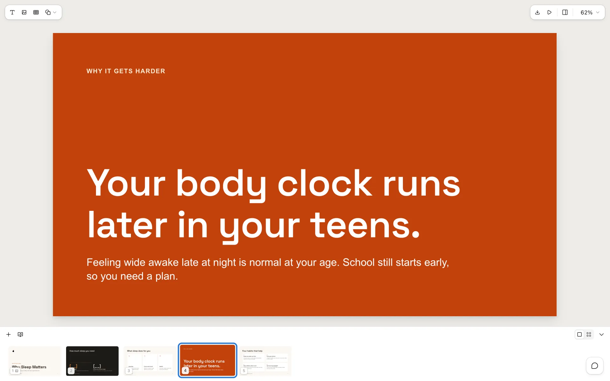
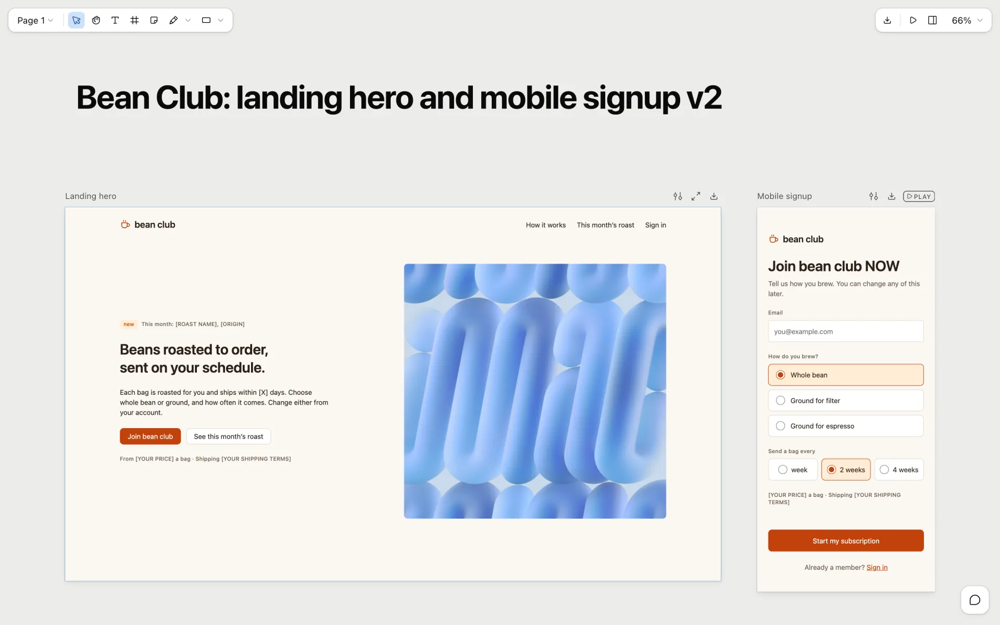
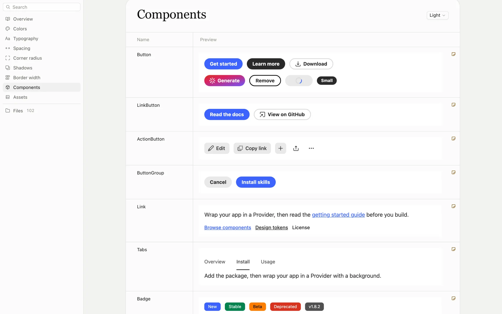
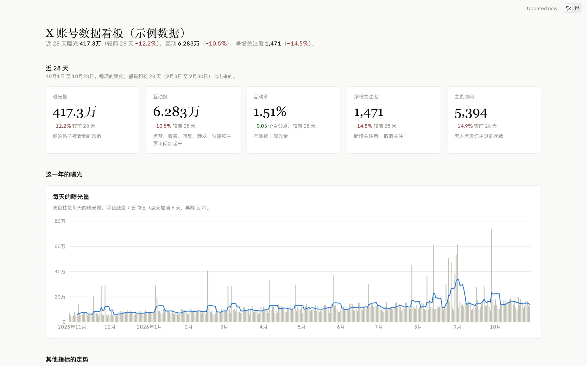

# baoyu-design


https://github.com/user-attachments/assets/d5b4f39b-a701-49de-87b8-64f3c6ef9c61


**在你自己的本地 Agent 上运行 Claude Design —— Cursor、Claude Code、Claude Desktop，或任何能读写文件的编码 Agent。**

[English](README.md) · [简体中文](README.zh-CN.md) · [更新日志](CHANGELOG.zh.md)

[](NOTICE.md)  

本仓库把 claude.ai 的 **Artifact 类型**搬到本地 Agent 上：可编辑的幻灯片、设计画布、设计系统和数据仪表盘，每一种都用它自己的编辑器打开，编辑器就运行在你的电脑上。第五个技能 `dataviz` 是一份图表指南：Agent 在画任何图表之前先读它，不管是在这几个技能里还是别处。四个编辑器也做成了 [DeepSeek Harness 插件](#deepseek-harness-插件)，按包名从 npm 安装。

原来的 `baoyu-design` 技能（以自包含 HTML 产出 UI 稿和原型）已归档到 [`archive/baoyu-design/`](archive/baoyu-design/)。

不依赖网站，不需要额外订阅，也不用上传。活儿由你机器上已有的 Agent 完成，所有产物都留在你自己的仓库里。

---

## 仓库里的技能

| 技能 | 产出 | 在哪里修改 |
|---|---|---|
| [`claude-slides`](skills/claude-slides/) | 幻灯片：`project/deck.json` 加上每页一个 HTML 文件 | 幻灯片编辑器：放映、改字、拖动；导出 PDF、HTML 或 PowerPoint |
| [`claude-design`](skills/claude-design/) | 一块画布上的多个画板：`project/canvas.json` 加上 `.dc.html` 设计组件 | 画布编辑器：并排查看画板、播放原型、改文案、调 tweaks；导出 HTML、PDF 或 PNG |
| [`claude-design-system`](skills/claude-design-system/) | 设计系统：tokens、README 品牌手册、组件预览、字体、素材分组 | 设计系统编辑器：浏览和编辑颜色、字体、组件和素材 |
| [`claude-dashboard`](skills/claude-dashboard/) | 数据驱动的仪表盘：数据集（CSV、TSV、JSON）加上基于它们的图表、数字和表格页面 | 仪表盘页面：实时图表、筛选，以及能把每个数字追溯到原始行的 Sources 面板 |
| [`dataviz`](skills/dataviz/) | 在任何载体里（HTML、SVG、d3、matplotlib、plotly…）把图表做好：选图表形式、在浅色和深色下以及色弱读者都看得清的配色、图形标记、图例和提示框，附带配色校验脚本 | 不需要打开：Agent 写图表代码前先读它；把 [`palette.md`](skills/dataviz/references/palette.md) 换成你自己品牌的颜色即可 |

---

## Artifact 技能：可编辑的幻灯片、画布、设计系统与仪表盘

这四个技能按该 Artifact 类型自己的文件格式把内容写进一个文件夹，再用这个类型的编辑器页面打开它，编辑器就在你自己的电脑上运行。Agent 写文件，编辑器立刻显示每一次写入；你在编辑器里的修改也会存回同一批文件，所以你和 Agent 可以轮流改。

在幻灯片、画布和设计系统编辑器里，点击 **Comment**（或按 **C**）就能对元素或区域留下评论。评论保存在项目本地的 `comments.json`，Agent 通过 `artifact.mjs` 读取和回复。Agent 用 `comments <root> --wait` 等待评论时，编辑器会显示 **Send to agent**，让你把评论交给它处理。

### `claude-slides`：幻灯片



一套幻灯片就是 `project/deck.json` 加上每页一个 HTML 文件。在编辑器里可以全屏放映、直接改字、拖动元素，插入文字、图片、表格和形状，并导出成 PDF、HTML 或 PowerPoint。*上图：一份讲睡眠的 5 页健康课幻灯片，用的是一套示例设计系统。*

### `claude-design`：多画板画布



一块画布上并排放着多个画板：`project/canvas.json` 加上每个画板一个 `.dc.html` 设计组件。画板可以当成能交互的原型来播放，在画布上播或者全屏播；也可以改文案、调 tweaks、贴便签；整份设计能导出成独立的 HTML 页面、PDF 或 PNG 图片（1× 或 2×，多个画板打包成 .zip）。*上图：一个咖啡订阅服务的落地页首屏，旁边是它的手机版注册表单。*

### `claude-design-system`：设计系统



一套设计系统包括 tokens、README 品牌手册、组件预览、字体和素材分组。在编辑器里可以浏览和编辑颜色、字体、间距、圆角、阴影、组件和素材。从组件库导入的设计系统，组件预览用的就是真组件，可以直接交互。幻灯片和画布可以安装它，之后编辑器的主题和颜色菜单就会列出它的颜色和文字样式。*上图：Nimbus，一套给天气应用做的小型设计系统。*

### `claude-dashboard`：数据仪表盘



一个仪表盘就是数据集（CSV、TSV 或 JSON）加上一页基于它们算出来的图表、数字和表格。图表是实时的，Sources 面板能把每个数字追溯到原始数据行。拿到新导出的数据交给 Agent，它会把文件换上，页面上的数字全部重算。数字、日期和说明文字都跟着你的语言走。*上图：一年的 X 账号每日数据，用的是示例数据。*

### 运行编辑器

每个 `SKILL.md` 都基本原样保留了该类型的英文原版说明，只把 Artifact 工具的调用换成了本地的等价操作。这个工具就放在每个技能里，是 `scripts/artifact.mjs`（Node 20+，仪表盘需 Node 22+；无需安装依赖）。平时 Agent 会替你运行；手动运行的话：

```bash
node skills/claude-slides/scripts/artifact.mjs open designs/q3-review             # 启动编辑器，打印网址
node skills/claude-slides/scripts/artifact.mjs check designs/q3-review            # 校验文件
node skills/claude-slides/scripts/artifact.mjs upload designs/q3-review hero.jpg  # 存入图片，打印它的 /_blob/ 地址
node skills/claude-slides/scripts/artifact.mjs list                                 # 查找磁盘上的设计系统
```

仪表盘也用同一个脚本（`write-db`、`read-db`、`upload`、`check`、`open`）写入它自己在 `<root>/db/` 下的存储。每个技能都运行自己的本地服务器，`scripts/` 里的文件都是预先构建好的 JavaScript，只要有 Node 就能运行，不用安装依赖，也不用构建。

---

## DeepSeek Harness 插件

四个编辑器技能也做成了 [DeepSeek Harness](https://github.com/deepseek-ai/deepseek-harness) 插件，发布在 npm 上。每个插件带着本仓库发布的那份技能，连同预先构建好的编辑器，让 Claude Design 这几个编辑器跑在你的 DeepSeek Agent 上。

| npm 包名 | 加入的技能 | 版本 |
|---|---|---|
| [`dsh-claude-slides`](https://www.npmjs.com/package/dsh-claude-slides) | `/claude-slides`：幻灯片 | [](https://www.npmjs.com/package/dsh-claude-slides) |
| [`dsh-claude-design`](https://www.npmjs.com/package/dsh-claude-design) | `/claude-design`：设计画布 | [](https://www.npmjs.com/package/dsh-claude-design) |
| [`dsh-claude-design-system`](https://www.npmjs.com/package/dsh-claude-design-system) | `/claude-design-system`：设计系统 | [](https://www.npmjs.com/package/dsh-claude-design-system) |
| [`dsh-claude-dashboard`](https://www.npmjs.com/package/dsh-claude-dashboard) | `/claude-dashboard`：数据仪表盘 | [](https://www.npmjs.com/package/dsh-claude-dashboard) |

幻灯片、画布和设计系统编辑器里的评论可以直接交给 Agent：Agent 每次打开编辑器，插件都会开始等评论。在页面上标注，勾选 **Send to agent**，Agent 就会醒来，读你的评论，改好页面，再在评论串里回复你。评论也会以卡片的形式出现在对话里。

### 从 npm 安装

只需要 DeepSeek Harness 桌面版，不用克隆仓库，也不用构建。应用会从 npm 下载插件（连不上 npm 时改从 npmmirror 镜像下载），用它自带的 Node.js 运行。

1. 在应用里打开 **Plugins** → **Add plugin**。
2. 在 **Package name or address** 一栏填表里的包名，比如 `dsh-claude-design`，点 **Install**。插件的开关没开就打开。要装几个就重复几次。
3. 退出应用再重新打开，然后新开一个会话，直接说要幻灯片、画布、设计系统或仪表盘，或者输入 `/claude-design`（`/claude-slides` 等）。

用命令行装到某个 CLI profile（比如 `web`）：

```bash
dsh plugin --profile web add dsh-claude-design
```

**从「发现」安装。** 应用的实验功能「发现」（Discover）可以列出这些插件，点一下就装，有新版本时也会标出来。在插件页点 **Experimental plugins**（实验性插件）旁边的 **More**（更多），打开 **Custom plugin markets**（自定义插件市场）；再到「发现」里点 **Add index source**（添加索引源），加上这个索引：

```text
https://jimliu.github.io/baoyu-design/dsh-plugins/index.json
```

**更新。** 应用不会自动更新插件；加了索引以后，「发现」会把有新版本的插件标成 **Update available**（有新版本）。在插件页卸载插件，再从「发现」或按包名重新安装，然后退出应用再重新打开。新版本发布后的一天内，按包名装到的还是上一个版本；从「发现」安装能马上装到新版本，在包名后面加上版本号也可以，比如 `dsh-claude-design@2.4.0`（版本号见 [更新日志](CHANGELOG.zh.md)）。

工作区里如果有自己的同名技能（在 `.agents/skills/` 或 `.dsh/skills/` 下），会用那一份，不用插件里的。一步一步的安装（包括从文件夹安装）、使用、更新、卸载和常见问题，见 [`dsh-plugins/`](dsh-plugins/README.zh-CN.md)。

---

## 为什么在本地跑

- **摆脱对网站的依赖。** 不必离开编辑器，就能用上 `claude.ai/design` 绝大部分的功能 —— 同一套方法论、同样的工艺标准、同样的产出格式。
- **搭配 Opus 5.5 效果最佳。** 这个技能本身是一份冗长且要求很高的设计指令，模型越强、效果越好。建议搭配 **Claude Opus 5.5** 获得最佳结果；在其他能力足够的模型上也能良好运行。
- **和 Agent 轮流改。** 每个编辑器都跑在 `localhost` 上，你在编辑器里的修改会存回 Agent 写的同一批文件。
- **一切都归你所有。** 产物落在 `designs/<slug>/` 下，是可以纳入版本控制、二次分叉、导出或直接上线的普通文件。

---

## 快速开始

用 DeepSeek Harness 桌面版的话，不用看这一节，直接 [从 npm 安装插件](#从-npm-安装)。

### 前置条件

- 一个本地 Agent —— **[Cursor](https://cursor.com)**、**[Claude Code](https://claude.com/claude-code)**、**[Codex](https://developers.openai.com/codex/)**，或安装器支持的其余 70+ 个 Agent（Cline、Roo Code、GitHub Copilot……）。其中 Cursor、Claude Code 与 Codex 在技能里内置了一等的工具参考文档。
- 模型选择 **Claude Opus 5.5**，效果最佳。
- **Node.js**，用于运行下面的 `npx` 安装器，以及 Artifact 技能的编辑器（Node 20+，仪表盘需 Node 22+）。

### 安装

**推荐方式 —— `skills` CLI。** [`npx skills`](https://github.com/vercel-labs/skills)（来自 Vercel Labs）会读取本仓库，找到 `skills/` 下的技能，并把它们放进所检测到的 Agent 对应的目录里：

```bash
# 安装到当前项目（自动检测你的 Agent）
npx skills add JimLiu/baoyu-design

# …或全局安装，对所有项目生效
npx skills add JimLiu/baoyu-design -g

# 指定某个具体的 Agent
npx skills add JimLiu/baoyu-design --agent claude-code
npx skills add JimLiu/baoyu-design --agent cursor
npx skills add JimLiu/baoyu-design --agent codex

# 先列出仓库里有哪些技能
npx skills add JimLiu/baoyu-design --list

# 只安装其中几个技能
npx skills add JimLiu/baoyu-design --skill claude-slides --skill claude-dashboard
```

它会把技能装到 Claude Code 的 `.claude/skills/`，以及 Cursor/Codex 风格 Agent 的 `.agents/skills/`（加上 `-g` 则装到 `~/` 级别的用户目录）。

### 更新

如果你是通过 `skills` CLI 安装的，可以在终端里更新：

```bash
# 更新某个技能（CLI 会提示选择安装范围）
npx skills update claude-slides

# 更新项目级或全局安装
npx skills update claude-slides -p -y
npx skills update claude-slides -g -y
```

`upgrade` 也可以作为别名使用。

也可以直接运行 `npx skills update` 来更新所有已安装的技能。更新后，请重启 Claude Code（或开启一个新的 Agent 会话），让新的技能文件被重新加载。

**备选方式 —— 直接把仓库 URL 发给 Agent。** 不想安装任何东西？把链接贴进对话，让 Agent 自己去拉取技能：

> 阅读 https://github.com/JimLiu/baoyu-design 并按照其中的 `skills/claude-slides/SKILL.md`，根据这份 PRD 做一套 10 页的幻灯片。

Agent 会 clone 或抓取该仓库、加载 `SKILL.md` 然后开干 —— 临时用一次特别合适。

### 开始使用

技能装好（或被抓取）之后，直接说你要什么（*「根据这份 PRD 做一套 12 页的幻灯片」*、*「把这个 CSV 做成仪表盘」*），或者点名调用：Claude Code 里用 `/claude-slides`、`/claude-design`、`/claude-design-system` 或 `/claude-dashboard`，Codex 里用 `$claude-slides` 等。Agent 会把文件写到 `designs/<slug>/` 下，启动编辑器，再把它的 `http://127.0.0.1` 地址给你。

---

## 示例 Prompt

- *「用 claude-slides 做一套 Q3 复盘的幻灯片，然后导出成 PowerPoint。」*
- *「在 claude-design 画布上并排放一个落地页和它的手机版。」*
- *「把 Chakra UI 组件库做成一套设计系统，组件预览要能直接交互。」*
- *「把这份数据分析 CSV 做成仪表盘，对比最近 28 天和再往前 28 天。」*

想要最好的效果，**请给它设计上下文** —— 截图、设计系统或代码库。从真实上下文出发，是对质量影响最大的一个杠杆；如果你不提供，技能也会主动向你索要。

---

## 致谢与许可

本项目把 **Anthropic** 出品的 claude.ai Artifact 类型和设计技能重新打包，使其得以在本地 Agent 上运行。这是一个独立的社区项目，与 Anthropic 无隶属或背书关系。

由 **Jim Liu 宝玉** 重新打包并维护。仓库里的内容分三类，许可各不相同，详见 [NOTICE.md](NOTICE.md)：

- **维护者自己写的部分**（本地命令行和编辑器服务器、本地评论、DeepSeek Harness 插件的代码、文档）基于 [MIT 许可证](LICENSE) 发布。
- **取自 Anthropic 的部分**权利归 Anthropic，不适用 MIT 许可，本项目也不授予任何许可。包括改编自 Artifact 类型的技能说明和参考文档、`dataviz` 技能、从 claude.ai 还原的编辑器、Anthropicons 图标字体，以及 `archive/` 里的 Claude Design 系统提示词、内置技能和起步组件。归档的 `frontend-design` 内置技能取自 Anthropic 以 Apache 2.0 发布的技能，许可全文放在它旁边。
- **第三方开源代码**（编辑器里打进去的开源包）各按原许可，清单在各编辑器的 `scripts/editor/third-party-licenses.txt`。

npm 上的 DeepSeek Harness 插件也带着同样的 `LICENSE` 和 `NOTICE.md`。
