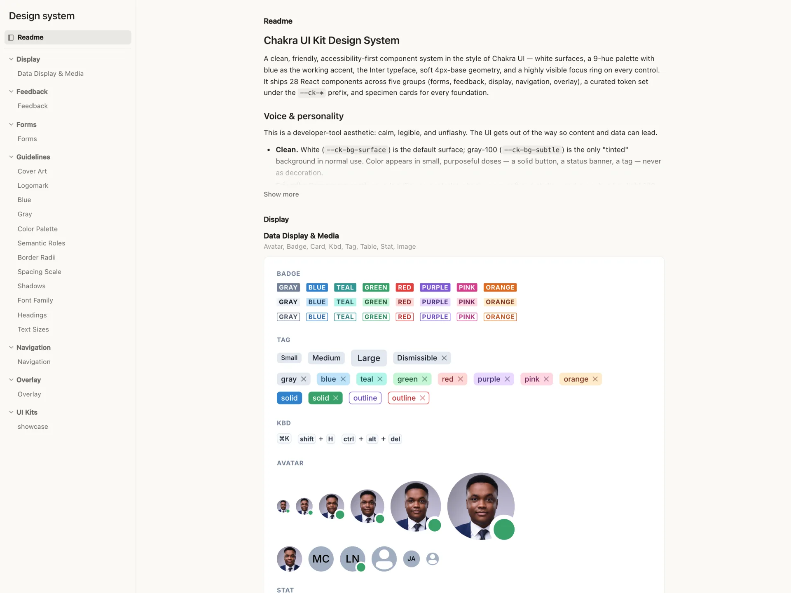

# baoyu-design


https://github.com/user-attachments/assets/d5b4f39b-a701-49de-87b8-64f3c6ef9c61


**在你自己的本地 Agent 上运行 Claude Design —— Cursor、Claude Code、Claude Desktop，或任何能读写文件的编码 Agent。**

[English](README.md) · [简体中文](README.zh-CN.md) · [更新日志](CHANGELOG.zh.md)

  

`baoyu-design` 把 **Claude Design**（[claude.ai/design](https://claude.ai/design) 背后的设计引擎）打包成一个可移植的 **Agent Skill（技能）**。把它放进本地 Agent，你就能在自己的编辑器里获得这个网站绝大部分的能力：精致的 UI 稿、可交互原型、线框图、落地页、仪表盘、移动 App、幻灯片 —— 全部以「自包含 HTML」的形式产出。

除此之外，仓库里还有四个技能，把 claude.ai 的 **Artifact 类型**搬到同样的 Agent 上：可编辑的幻灯片、设计画布、设计系统和数据仪表盘，每一种都用它自己的编辑器打开，编辑器就运行在你的电脑上。第六个技能 `dataviz` 是一份图表指南：Agent 在画任何图表之前先读它，不管是在这几个技能里还是别处。

不依赖网站，不需要额外订阅，也不用上传。活儿由你机器上已有的 Agent 完成，所有产物都留在你自己的仓库里。

---

## 仓库里的技能

| 技能 | 产出 | 在哪里修改 |
|---|---|---|
| [`baoyu-design`](skills/baoyu-design/) | UI 稿、可交互原型、线框图、落地页、幻灯片和动画，以自包含 HTML 的形式放在 `designs/<项目名>/` 下 | Agent 自带的网页预览：点选元素，说出想怎么改 |
| [`claude-slides`](skills/claude-slides/) | 幻灯片：`project/deck.json` 加上每页一个 HTML 文件 | 幻灯片编辑器：放映、改字、拖动；导出 PDF、HTML 或 PowerPoint |
| [`claude-design`](skills/claude-design/) | 一块画布上的多个画板：`project/canvas.json` 加上 `.dc.html` 设计组件 | 画布编辑器：并排查看画板、播放原型、改文案、调 tweaks；导出 HTML、PDF 或 PNG |
| [`claude-design-system`](skills/claude-design-system/) | 设计系统：tokens、README 品牌手册、组件预览、字体、素材分组 | 设计系统编辑器：浏览和编辑颜色、字体、组件和素材 |
| [`claude-dashboard`](skills/claude-dashboard/) | 数据驱动的仪表盘：数据集（CSV、TSV、JSON）加上基于它们的图表、数字和表格页面 | 仪表盘页面：实时图表、筛选，以及能把每个数字追溯到原始行的 Sources 面板 |
| [`dataviz`](skills/dataviz/) | 在任何载体里（HTML、SVG、d3、matplotlib、plotly…）把图表做好：选图表形式、在浅色和深色下以及色弱读者都看得清的配色、图形标记、图例和提示框，附带配色校验脚本 | 不需要打开：Agent 写图表代码前先读它；把 [`palette.md`](skills/dataviz/references/palette.md) 换成你自己品牌的颜色即可 |

---

## Artifact 技能：可编辑的幻灯片、画布、设计系统与仪表盘

`baoyu-design` 产出的是自包含的 HTML；这四个技能则按该 Artifact 类型自己的文件格式把内容写进一个文件夹，再用这个类型的编辑器页面打开它，编辑器就在你自己的电脑上运行。Agent 写文件，编辑器立刻显示每一次写入；你在编辑器里的修改也会存回同一批文件，所以你和 Agent 可以轮流改。

在幻灯片、画布和设计系统编辑器里，点击 **Comment**（或按 **C**）就能对元素或区域留下评论。评论保存在项目本地的 `comments.json`，Agent 通过 `artifact.mjs` 读取和回复。Agent 用 `comments <root> --wait` 等待评论时，编辑器会显示 **Send to agent**，让你把评论交给它处理。

### `claude-slides`：幻灯片


一套幻灯片就是 `project/deck.json` 加上每页一个 HTML 文件。在编辑器里可以全屏放映、直接改字、拖动元素，插入文字、图片、表格和形状，并导出成 PDF、HTML 或 PowerPoint。*上图：一份 20 页的图书策划案。*

### `claude-design`：多画板画布


一块画布上并排放着多个画板：`project/canvas.json` 加上每个画板一个 `.dc.html` 设计组件。画板可以当成能交互的原型来播放，在画布上播或者全屏播；也可以改文案、调 tweaks、贴便签；整份设计能导出成独立的 HTML 页面、PDF 或 PNG 图片（1× 或 2×，多个画板打包成 .zip）。*上图：这个仓库的介绍落地页，旁边是它的手机版，用的是 React Spectrum 设计系统。*

### `claude-design-system`：设计系统


一套设计系统包括 tokens、README 品牌手册、组件预览、字体和素材分组。在编辑器里可以浏览和编辑颜色、字体、间距、圆角、阴影、组件和素材。从组件库导入的设计系统，组件预览用的就是真组件，可以直接交互。幻灯片和画布可以安装它，之后编辑器的主题和颜色菜单就会列出它的颜色和文字样式。*上图：从 Adobe 组件库导入的 React Spectrum（Spectrum 2）。*

### `claude-dashboard`：数据仪表盘


一个仪表盘就是数据集（CSV、TSV 或 JSON）加上一页基于它们算出来的图表、数字和表格。图表是实时的，Sources 面板能把每个数字追溯到原始数据行。拿到新导出的数据交给 Agent，它会把文件换上，页面上的数字全部重算。数字、日期和说明文字都跟着你的语言走。*上图：一年的 X 账号每日数据，用的是示例数据。*

### 运行编辑器

每个 `SKILL.md` 都基本原样保留了该类型的英文原版说明，只把 Artifact 工具的调用换成了本地的等价操作。这个工具就放在每个技能里，是 `scripts/artifact.mjs`（Node 20+，仪表盘需 Node 22+；无需安装依赖）。平时 Agent 会替你运行；手动运行的话：

```bash
node skills/claude-slides/scripts/artifact.mjs open designs/q3-review             # 启动编辑器，打印网址
node skills/claude-slides/scripts/artifact.mjs check designs/q3-review            # 校验文件
node skills/claude-slides/scripts/artifact.mjs upload designs/q3-review hero.jpg  # 存入图片，打印它的 /_blob/ 地址
node skills/claude-slides/scripts/artifact.mjs list                                 # 查找磁盘上的设计系统
```

仪表盘也用同一个脚本（`write-db`、`read-db`、`upload`、`check`、`open`）写入它自己在 `<root>/db/` 下的存储。每个技能都运行自己的本地服务器，`scripts/` 里的文件都是预先构建好的 JavaScript，只要有 Node 就能运行，不用安装依赖，也不用构建。

---

## 为什么在本地跑

- **摆脱对网站的依赖。** 不必离开编辑器，就能用上 `claude.ai/design` 绝大部分的功能 —— 同一套方法论、同样的工艺标准、同样的产出格式。
- **搭配 Opus 5.5 效果最佳。** 这个技能本身是一份冗长且要求很高的设计指令，模型越强、效果越好。建议搭配 **Claude Opus 5.5** 获得最佳结果；在其他能力足够的模型上也能良好运行。
- **用「指」代替「描述」来迭代。** 因为产物就是跑在 `localhost` 上的普通 HTML，你可以充分借助 Agent 自带的网页预览与元素标注能力（Cursor Browser / DevTools、Claude Preview 或 Codex Browser）：在实时预览里直接点选某个按钮，说出想改成什么，Agent 就会去改对应的源码 —— 这是一条紧凑、可视化的「二次编辑」回路，在网站上很难做到。
- **一切都归你所有。** 产物会落到 `designs/<项目名>/` 目录下，是可以纳入版本控制、二次分叉、导出或直接上线的自包含 HTML。

---

## 快速开始

### 前置条件

- 一个本地 Agent —— **[Cursor](https://cursor.com)**、**[Claude Code](https://claude.com/claude-code)**、**[Codex](https://developers.openai.com/codex/)**，或安装器支持的其余 70+ 个 Agent（Cline、Roo Code、GitHub Copilot……）。其中 Cursor、Claude Code 与 Codex 在技能里内置了一等的工具参考文档。
- 模型选择 **Claude Opus 5.5**，效果最佳。
- **Node.js**，用于运行下面的 `npx` 安装器，以及 Artifact 技能的编辑器（Node 20+，仪表盘需 Node 22+）。另外备一个 **Python 3** 跑 `baoyu-design` 的本地预览服务器会很方便。

### 安装

**推荐方式 —— `skills` CLI。** [`npx skills`](https://github.com/vercel-labs/skills)（来自 Vercel Labs）会读取本仓库，找到 `skills/` 下的技能，并把它们放进所检测到的 Agent 对应的目录里：

```bash
# 安装到当前项目（自动检测你的 Agent）
npx skills add JimLiu/baoyu-design

# …或全局安装，对所有项目生效
npx skills add JimLiu/baoyu-design -g

# 指定某个具体的 Agent
npx skills add JimLiu/baoyu-design --agent claude-code
npx skills add JimLiu/baoyu-design --agent cursor
npx skills add JimLiu/baoyu-design --agent codex

# 先列出仓库里有哪些技能
npx skills add JimLiu/baoyu-design --list

# 只安装其中几个技能
npx skills add JimLiu/baoyu-design --skill baoyu-design --skill claude-slides
```

它会把技能装到 Claude Code 的 `.claude/skills/`，以及 Cursor/Codex 风格 Agent 的 `.agents/skills/`（加上 `-g` 则装到 `~/` 级别的用户目录）。

### 更新

如果你是通过 `skills` CLI 安装的 `baoyu-design`，可以在终端里更新：

```bash
# 更新并让 CLI 提示选择安装范围
npx skills update baoyu-design

# 更新当前项目级安装
npx skills update baoyu-design -p -y

# 更新全局安装
npx skills update baoyu-design -g -y
```

`upgrade` 也可以作为别名使用：

```bash
npx skills upgrade baoyu-design
```

也可以直接运行 `npx skills update` 来更新所有已安装的技能。更新后，请重启 Claude Code（或开启一个新的 Agent 会话），让新的技能文件被重新加载。

**备选方式 —— 直接把仓库 URL 发给 Agent。** 不想安装任何东西？把链接贴进对话，让 Agent 自己去拉取技能：

> 阅读 https://github.com/JimLiu/baoyu-design 并按照其中的 `skills/baoyu-design/SKILL.md`，帮我设计一个冥想 App 的设置页面。

Agent 会 clone 或抓取该仓库、加载 `SKILL.md` 然后开干 —— 临时用一次特别合适。

### 开始使用

技能装好（或被抓取）之后，直接用自然语言描述设计任务即可 —— 它会根据自身描述自动激活：

> 帮我设计一个冥想 App 设置页面的 3 个高保真方案。

在 Claude Code 里你也可以用 `/baoyu-design` 显式触发；在 Codex 里，如果 Skills 可用，可以提到 `$baoyu-design`。Agent 会问几个澄清问题、在 `designs/` 下生成 HTML，并通过 `localhost` 预览。**在实时预览里点选任意元素，说出想改成什么** —— Agent 就会去改对应源码，完成一次快速、可视化的二次编辑。

Artifact 技能的用法也一样。直接说你要什么（*「根据这份 PRD 做一套 12 页的幻灯片」*、*「把这个 CSV 做成仪表盘」*），或者点名调用：Claude Code 里用 `/claude-slides`、`/claude-design`、`/claude-design-system` 或 `/claude-dashboard`，Codex 里用 `$claude-slides` 等。Agent 会把文件写到 `designs/<slug>/` 下，启动编辑器，再把它的 `http://127.0.0.1` 地址给你。

### 预览服务器

交付物通过 HTTP 预览（多文件原型无法从 `file://` 加载）。通常 Agent 会自动帮你起服务；若要手动运行：

```bash
python3 -m http.server 4311 --directory designs
# 然后打开 http://localhost:4311/<项目名>/<文件名>.html
```

---

## baoyu-design 能做什么

本页余下部分讲的都是 `baoyu-design`。这个技能会驱动一套完整的设计流程 —— 先问澄清问题 → 收集设计上下文 → 产出一个或多个 HTML 交付物 → 预览并校验。它内置了**一大批子技能**，外加一组开箱即用的组件脚手架。

| 类别 | 内置子技能 |
|---|---|
| **核心设计** | 高保真设计 · 可交互原型 · 线框图 · 前端美学方向 |
| **幻灯片** | 制作演示文稿 · 演讲者备注 |
| **移动与动效** | 移动端原型 · 动画视频 · 音效 |
| **网站与营销** | 网站与落地页 · 社交媒体内容 · HTML 邮件 · 传单 · 三折页 |
| **数据与研究** | 网页研究 · 数据科学 · 数据可视化 · 地图与地理 · 实验工作流 |
| **文档、3D 与插画** | 制作文档 · 3D 对象 · 水彩插画 |
| **设计系统** | 创建设计系统 · 使用设计系统 · 设计系统预览 · 设计组件（`.dc.html`）· 可调参数化 |
| **导入设计源** | Figma `.fig`（离线解码）· GitHub 仓库 · 现成 HTML/CSS |
| **导出与交付** | 独立 HTML · PDF · PPTX（可编辑）· PPTX（截图）· 视频（MP4）· 导出到 Figma · 导出到 Canva · 交接给 Claude Code |
| **AI 素材与集成** | Gemini 图像生成 · 在原型中调用 Claude · 读取 PDF |

**起步组件**（位于 [`starter-components/`](skills/baoyu-design/starter-components/)）让 Agent 不必从零手搓基础件：设备、浏览器和社交媒体外壳；可平移缩放的设计画布；幻灯片、动画、图表、文档、文件和 3D 舞台；参数调节面板；可填充的图片占位槽；以及能逐笔回放水彩画的绘画运行时。

---

## baoyu-design 的工作原理

整个技能就是纯 Markdown 加几个 JSX/JS 脚手架 —— 无需构建、无需运行时。

```
skills/baoyu-design/
├── SKILL.md              # 入口 —— 编排整个流程
├── system-prompt.md      # 设计方法论与工艺标准（唯一事实来源）
├── references/
│   ├── claude.md         # Claude Code 的工具映射
│   ├── cursor.md         # Cursor 的工具映射
│   └── codex.md          # Codex Agent 的工具映射
├── built-in-skills/      # 专项子技能（幻灯片、移动端、导入、导出……）
└── starter-components/   # 设备/社交外壳、幻灯片、图表、文档、3D、动画……
```

当你提出设计需求时，Agent 会读取 `SKILL.md`，从 `system-prompt.md` 加载核心方法论，判断自己运行在 Cursor、Claude Code、Codex Agent，还是一个通用的可读写文件 harness；如果有匹配的参考文档，就读取对应文档，然后只按需载入这次任务用得到的子技能。这种拆分让「工艺规则」与具体 Agent 无关，而每个环境各自去解析自己的工具来完成「提问」「预览」「截图」「校验」。

---

## baoyu-design 里的设计系统

除了一次性的设计稿，`baoyu-design` 还能让整个项目都遵循某个**设计系统** —— 也就是把一个品牌的 token、字体、组件和完整 UI Kit 打包成的、带版本的产物。设计系统和你的项目一起放在 `designs/` 下：你可以用**创建设计系统**子技能自己做一个、直接放入一个现成的，或者从 Figma `.fig` 文件导入一个（见下一节）。系统一旦存在，下面两条流程就能让任意项目使用它。

### 导入现有设计系统

当你开始一个设计时，Agent 会先问你**保存到哪里**以及**使用哪个（些）设计系统** —— 它会发现 `designs/` 下的所有系统并列出来，你可以一个都不选（自由设计）、选一个，或选多个。如果一上来就点名某个系统，它会跳过这一步：

> 用 **Fluent 2** 设计系统，帮我设计一个设置页面。

对于你选中的每个系统，Agent 会把一份**自包含、锁定版本的副本**同步到项目里的 `_ds/<slug>/`，把它的 CSS 和组件 bundle 接入页面，并把这次绑定记录到项目的 `_d_meta.json` 里。正是这份本地副本让项目可移植、可复现 —— 不引用文件夹之外的任何东西；之后想拉取更新，重新跑一次导入即可。如果你选了多个系统，其中一个会成为**主系统** —— 它决定整体观感，并在 token 冲突时胜出，其余系统则贡献各自的特定组件。

### 使用已导入的设计系统

系统一旦绑定，它就是一份**具有约束力的视觉契约**，而非可有可无的建议：每个页面都用系统里真实的 token、字体、间距和组件来搭建，Agent 不会自创系统之外的颜色或样式。如果系统自带**起始点**（现成的页面或组件），你还可以从中挑一个作为种子，而不必从空白开始。

这份绑定会跟着项目走。之后再打开它，Agent 会读取 `_d_meta.json`、重新加载该系统，继续按同样的风格设计 —— 无需再次挑选。在此基础上，你可以**刷新**某个系统以拉取更新、**新增**另一个、**切换**主系统，或者把某个系统整个**移除**。

---

## 导入设计源

真实的上下文胜过千言万语。三个内置导入子技能，能把你手头已有的素材直接变成 Agent 的设计原料：

- **Figma `.fig` 文件 —— 完全离线解码。** 把任意 Figma 文件导出为 `.fig`（或下载一个社区 UI Kit）丢给 Agent，内置的解码器就会直接在你的机器上读取它 —— 不需要 Figma 账号、API token 或 MCP 服务。Agent 会先盘点页面、组件和变量，与你确认范围，然后既可以按需把组件挑出来转成 React 代码，也可以把整个 Kit 产出为一套设计系统：组件按语义重新分组、token CSS 按类别整理、SVG/PNG 资产从文件中原样提取（拷贝而非重画），外加规范卡片和一份品牌指南 README。
- **GitHub 仓库。** 把仓库 URL 作为设计源交给它。Agent 会先用 `gh api` 浏览目录树而不是直接 clone，再用 sparse-checkout 只取需要的路径到项目之外的临时目录，并把仓库 URL 记录为出处。
- **现成的 HTML/CSS。** 保存下来的网页或本地代码库都可以作为设计参考：Agent 读取真实的样式表而不是对着截图猜，把精确的取值（颜色、字体、间距、圆角、阴影、交互态）提取进项目自己的 CSS 变量，并把引用到的资产拷贝出来。

凡是以设计系统形式导入的内容，都会编译成一个自包含、可交互的 `preview.html`。下图就是社区版 **Chakra UI Figma Kit** 的 `.fig` 经过一次导入对话后的样子 —— 28 个按语义分组的组件、400 多个整理过的 token、规范卡片，外加一个自行创作的 showcase，全部可以在一个文件里浏览：



---

## 幻灯片与 PPTX 导出

让它做一套幻灯片，产出方式和别的交付物一样 —— 一个**自包含的 HTML 网页**，用 `deck-stage` 组件和**制作演示文稿**子技能搭建。因为幻灯片本身就是一个网页，整个编辑回路都发生在你已经在用的环境里：

- **用「指」来预览和修改。** 在 Agent 的网页预览里（Cursor Browser、Codex Browser 或 Claude Preview）打开幻灯片，点选某个标题或图表、说出想改成什么 —— 或者直接在聊天里说 —— Agent 就会去改这一页的源码。
- **全屏放映。** 按 **`F`** 键（或点击幻灯片工具栏里的全屏按钮）即可全屏放映，缩略图侧栏会自动隐藏。`Cmd/Ctrl+F` 不受影响，浏览器自带的查找照常可用。

### 幻灯片动画

幻灯片支持逐元素的构建动画，而且导出后依然保留。直接用嘴说就行 —— 「列表逐条出现」「图表在点击时飞入」「让小球沿弧线移动」—— Agent 会先按最终版式写好这一页，再给需要动画的元素加上 `data-anim` 属性：

```html
<li data-anim="fade-in" data-anim-trigger="click">第一点</li>
<li data-anim="fly-in" data-anim-dir="right" data-anim-trigger="click">第二点</li>

<div class="ball" data-anim="path" data-anim-path="C 100 -200 300 -200 400 0"></div>
```

- **效果：** 入场/退场 —— `appear`/`disappear`（出现/消失）、`fade`（淡入/淡出）、`fly`（四方向飞入/飞出）、`wipe`（四方向擦除）、`float`（浮入/浮出）、`split`（劈裂）、`bounce`（弹跳）、`zoom`（缩放）、`wheel`（轮子，扇形扫描）、`random-bars`（随机线条）、`blinds`（百叶窗）、`checkerboard`（棋盘）、`dissolve`（溶解）、`box`（盒状）、`circle`（圆形扩展）、`diamond`（菱形）、`plus`（十字形扩展）、`strips`（阶梯状，四角方向）、`wedge`（楔入），均有 `-in`/`-out` 成对形式；强调 —— `spin`（陀螺旋）、`grow`/`shrink`（放大/缩小）、`pulse`（脉冲）、`teeter`（跷跷板）；以及 `path` —— 由直线段和三次贝塞尔曲线组成的自定义路径动画。
- **时序：** `data-anim-trigger="click|with|after"` 与 PowerPoint 的「单击时 / 与上一动画同时 / 上一动画之后」一一对应（默认 `after`，所以只写一个 `data-anim="fade-in"` 就会在翻到该页时自动播放）；`data-anim-delay`、`data-anim-duration`、`data-anim-order` 用来微调时间线；`data-anim-repeat` 和 `data-anim-auto-reverse`（限 `spin`/`grow`/`shrink`/`path`）可以让旋转循环播放、让路径动画去而复返。
- **在浏览器里**，`deck-stage` 组件会实时播放构建动画 —— **→/空格键先逐步播放 click 门控的构建**，播完才翻页；往回翻则直接显示完整构建好的页面。打印、缩略图和 PDF 导出始终显示最终版式。
- **导出可编辑 PPTX 时**，这些属性会被自动识别（无需任何配置），写成**原生 PowerPoint 动画** —— 打开动画窗格，每个构建都在里面，可以继续调顺序、改时长。截图模式导出的是平面图片，动画会被跳过。

完整的属性参考见 [`make-a-deck.md`](skills/baoyu-design/built-in-skills/make-a-deck.md)（→ *Animations* 一节）。

幻灯片做好后，**在同一个会话里说一声就能导出成 PowerPoint** —— 「导出 PPTX」「export to PowerPoint」「做个 PPT」都会触发导出流程（它只导出本技能生成的幻灯片，而非任意 HTML 页面）。两种模式：

- **可编辑（editable）** —— 原生的 PowerPoint 文字、形状和图片，可以在 PowerPoint 或 Keynote 里继续编辑，排版与网页上的效果高度一致 —— `data-anim` 构建动画也会一并导出为原生 PowerPoint 动画。
- **截图（screenshots）** —— 每页一张整版 PNG：像素级还原，但不可编辑。

> **本地运行说明：** 在 `claude.ai/design` 上，导出 PPTX 用的是内置的 `gen_pptx` 工具 —— 当你把技能放到自己的 Agent 上跑时，这个工具并不存在。所以技能自带了一份本地 CLI（`agents/gen-pptx/`），用 Playwright 驱动无头 Chromium，再用内置（vendored）的 PptxGenJS 写出 `.pptx`。在 Claude Code 里，首次使用前需要构建一次（`cd skills/baoyu-design/agents/gen-pptx && npm install && npx playwright install chromium && npm run build`），之后 Agent 会自动起服务并调用这个 CLI 帮你完成导出。

### gen_pptx 的工作原理

核心思路：**不去解析 HTML，而是在真实浏览器里渲染它，再把渲染结果翻译成 PowerPoint。**

<p align="center"></p>

CLI 通过 Playwright 启动一个无头 Chromium，把幻灯片当作真网页加载（所以需要 `http://` URL，`file://` 不行）。一段捕获代码被注入页面、挂载为 `window.__genpptx`，Node 驱动端通过 `page.evaluate()` 与之通信 —— 所有依赖真实浏览器的工作（布局、计算样式、字体度量、图片解码）都在页面内完成，只把纯数据递回 Node。

在开始捕获之前，`setup()` 会藏掉导航条等 UI 元素、做字体替换（注入 `@font-face` 规则或从 Google Fonts 拉取）、清除 `transform: scale()` 缩放包装以确保测量值反映设计尺寸、等待 `document.fonts.ready`、并收集演讲者备注。

然后逐页处理 —— `showJs` 翻到每一页，延迟等过渡动画落定，对所有图片调用 `.decode()` 确认解码完成。接下来两种模式走不同的路：

- **截图模式**直接调用 `page.screenshot()`（`deviceScaleFactor: 2` 出高清），一页一张整版 PNG 贴进幻灯片。像素级还原，但在 PPT 里是一张平面图，改不了字。
- **可编辑模式**递归遍历活的 DOM，把每个元素序列化为 `{ tag, rect, style, children }` 的 JSON 树，文本用 `Range.getBoundingClientRect()` 拿到精确行盒。回到 Node 后，`renderNodeToPptx` 把每个节点翻译成 PptxGenJS 的原生对象：背景和边框 → `addShape`，文字 → `addText`（字体、字号、颜色全部取自计算样式），图片（含栅格化的 SVG 和 canvas 快照）→ `addImage`。坐标换算：`px ÷ 96 = 英寸`、字号换算：`px × 0.75 = 磅`。带 `data-anim` 的元素在渲染时会给它产出的每个形状打上标记，并在每页的 XML 里写入原生的 `<p:timing>` 动画时序树 —— 所以构建动画到了 PowerPoint 里是真正的动画，而不是烤死的像素。

最后做一轮校验：对相邻页做 djb2 哈希判断翻页是否生效、检查幻灯片尺寸是否匹配、核对演讲者备注数量 —— 结果以单行 JSON 打印，供 Agent 读取判断。

---

## 示例 Prompt

- *「用这张截图里的品牌风格，设计 3 个高保真的定价页方案。」*
- *「做一个可以真正交互的引导流程原型 —— 要有真实状态、过渡动画、表单校验。」*
- *「根据这份 PRD 做一套 10 页的幻灯片，用于工程全员会。」*
- *「让关键指标那一页逐条点击出现，然后带着动画导出成 PPTX。」*
- *「为一个移动端记账 App 的首页画几个布局线框方案。」*
- *「照着这个代码库复刻 composer 的 UI，然后导出成独立 HTML。」*
- *「把这个 UI Kit 的 `.fig` 导入成设计系统，再用它做一个仪表盘。」*
- *「用我们的设计系统做一个仪表盘，从它自带的分析页起步。」*
- *「用 claude-slides 做一套 Q3 复盘的幻灯片，然后导出成 PowerPoint。」*
- *「在 claude-design 画布上并排放一个落地页和它的手机版。」*
- *「把 Chakra UI 组件库做成一套设计系统，组件预览要能直接交互。」*
- *「把这份数据分析 CSV 做成仪表盘，对比最近 28 天和再往前 28 天。」*

想要最好的效果，**请给它设计上下文** —— 截图、UI Kit、Figma `.fig` 文件或代码库。从真实上下文出发，是对质量影响最大的一个杠杆；如果你不提供，技能也会主动向你索要。

---

## 致谢与许可

本项目把 **Anthropic** 出品、驱动 [claude.ai/design](https://claude.ai/design) 的设计技能 **Claude Design** 重新打包，使其得以在本地 Agent 上运行。这是一个独立的社区项目，与 Anthropic 无隶属或背书关系。

由 **Jim Liu 宝玉** 重新打包并维护。基于 [MIT 许可证](LICENSE) 发布。
